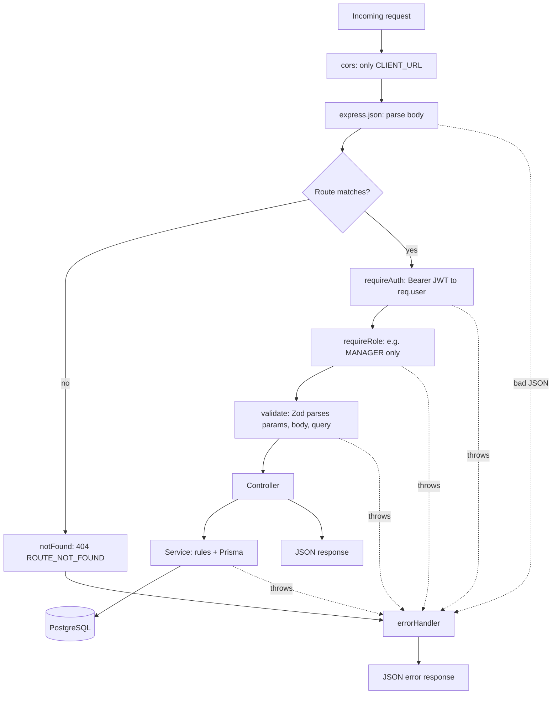
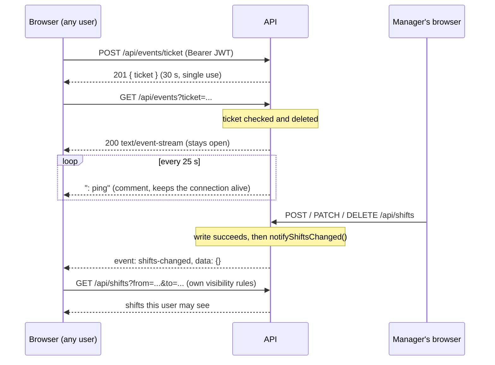

# Architecture

How ShiftHub is put together. For the reasons behind the main choices, see [DECISIONS.md](DECISIONS.md).

## Overview

ShiftHub has three parts:

- **Client:** a React single-page app, hosted on Vercel.
- **API:** an Express REST API, hosted on Render.
- **Database:** PostgreSQL on Neon, accessed only by the API through Prisma.

The client talks to the API over HTTPS with JSON requests, plus one long-lived Server-Sent Events (SSE) stream for realtime updates. The API's CORS policy allows exactly one origin: the client's URL (`CLIENT_URL`).

## Monorepo layout

```
shifthub/
├── client/   # React 19 + Vite + Tailwind CSS v4, its own package.json
├── server/   # Express 5 + Prisma 7, its own package.json
└── docs/     # this documentation
```

`client/` and `server/` are independent npm projects. They share no code and are built and deployed separately. Each has its own `.env.example`.

**Client (`client/src/`)**

| Folder | Contents |
| --- | --- |
| `lib/api.ts` | `apiFetch`: adds the Bearer token, parses the error format into an `ApiError`, logs out on 401. Also token storage and the auth endpoints. |
| `api/` | One module per resource: `shifts.ts`, `users.ts`, `events.ts`. |
| `auth/` | `AuthProvider` (checks a saved token via `/me` on start; `login()`, `register()`, `logout()`), `useAuth`, route guards, `registerForm.ts` (browser-side register checks). |
| `hooks/` | `useWeekShifts` (loads a week), `useEmployees`, `useShiftEvents` (realtime connection + status). |
| `components/` | `calendar/` (week grid, day columns, shift cards), `shifts/` (modal, form, details) and `auth/` (`AuthLayout`, the shared frame of the login and register pages). |
| `pages/` | `LoginPage` (`/login`) and `RegisterPage` (`/register`), only when logged out, and `HomePage` (`/`, only when logged in). Any other path redirects to `/`. |
| `lib/dates.ts` | Date helpers in local time, formatting with `Intl`. |

**Server (`server/src/`)**: see the next section.

## Server layers

Every endpoint follows the same path: **route → validate → controller → service**.

| Layer | Folder | Job | Rule |
| --- | --- | --- | --- |
| Routes | `routes/` | Map URL + method to middleware and a controller. One `Router` per resource, mounted under `/api/...` in `app.ts`. | No logic. Auth middleware runs before validation, so unauthorized callers learn nothing about the expected input. |
| Schemas | `schemas/` | Zod schemas for params, body and query, plus the TypeScript types inferred from them. | Every route is validated. |
| Controllers | `controllers/` | Read the validated request, call a service, pick the status code. | No business rules, no Prisma. |
| Services | `services/` | Business rules and database access. | No Express types. They receive plain values (for example an `Actor = { id, role }`), so they could be called from anywhere. |
| Middleware | `middleware/` | `validate`, `requireAuth`, `requireRole`, `notFound`, `errorHandler`. | `notFound` and `errorHandler` are mounted last. |
| Errors | `errors/AppError.ts` | `AppError(statusCode, message, code, details?)` for expected errors. | Services throw it; `errorHandler` turns it into a response. |
| Lib | `lib/` | The shared `PrismaClient` and JWT sign/verify. | Only one `PrismaClient` in the whole app. |
| Config | `config/env.ts` | Checks `JWT_SECRET` and `JWT_EXPIRES_IN` with Zod at startup and exits on bad values. | Prints variable names, never values. |

Express 5 forwards errors thrown in async handlers to the error handler automatically, so there are no `try/catch` wrappers in controllers.

## Request lifecycle



`requireAuth` and `requireRole` are only on the routes that need them (see the endpoint table).

### Error format

Every error response has the same shape:

```json
{ "error": { "message": "string", "code": "STRING_CODE", "details": "optional, any JSON" } }
```

`details` is only present when it carries information, for example the per-field errors of a validation failure:

```json
{ "error": { "message": "Validation failed", "code": "VALIDATION_ERROR", "details": { "endTime": ["endTime must be after startTime"] } } }
```

| Status | Code | When |
| --- | --- | --- |
| 400 | `VALIDATION_ERROR` | Invalid params, body or query. `details` lists errors per field; problems with the whole object become the `message`. |
| 400 | `INVALID_JSON` | The request body is not valid JSON. |
| 400 | `INVALID_REFERENCE` | `employeeId` doesn't match an existing user (Prisma `P2003`). |
| 401 | `UNAUTHORIZED` | Missing or malformed `Authorization` header, invalid or expired token, or the user no longer exists (`/me`). |
| 401 | `INVALID_CREDENTIALS` | Wrong password or unknown email (same message for both). |
| 401 | `INVALID_TICKET` | SSE ticket unknown, expired or already used (same message for all three). |
| 403 | `FORBIDDEN` | Logged in, but the role isn't allowed (or an employee filtered by someone else's id). |
| 404 | `SHIFT_NOT_FOUND` | No shift with this id, or one the caller may not see. |
| 404 | `NOT_FOUND` | A record to update or delete doesn't exist (Prisma `P2025`). |
| 404 | `ROUTE_NOT_FOUND` | Unknown URL. |
| 409 | `SHIFT_OVERLAP` | The employee already has a shift during this time. `details.conflictingShift` shows which one. |
| 409 | `EMAIL_TAKEN` | Register with an email that already exists. |
| 500 | `INTERNAL_ERROR` | Anything unexpected. The error's message and stack trace are included only when `NODE_ENV` is not `production`. |

## API endpoints

All paths start with `/api`. "Auth" means the request needs `Authorization: Bearer <token>`.

| Method | Path | Access | Description | Success |
| --- | --- | --- | --- | --- |
| GET | `/health` | Public | API status and whether the database answers (`database: "connected"` or `"error"`). | 200 |
| POST | `/auth/register` | Public | Create an account (`name`, `email`, `password`). Always an employee. Returns `{ token, user }`. | 201 |
| POST | `/auth/login` | Public | Log in (`email`, `password`). Returns `{ token, user }`. | 200 |
| GET | `/auth/me` | Auth | The current user. | 200 |
| GET | `/shifts` | Auth | Shifts visible to the caller, ordered by start time. Optional `from` + `to` (together) and `employeeId`. | 200 |
| GET | `/shifts/:id` | Auth | One shift, if visible to the caller. | 200 |
| POST | `/shifts` | Manager | Create a shift. | 201 |
| PATCH | `/shifts/:id` | Manager | Update a shift: send only the fields to change, at least one. | 200 |
| DELETE | `/shifts/:id` | Manager | Delete a shift. | 204 |
| GET | `/users` | Manager | All users (`id`, `name`, `email`, `role`), sorted by name. Optional `role` filter. | 200 |
| POST | `/events/ticket` | Auth | A single-use ticket for the event stream: `{ ticket }`. | 201 |
| GET | `/events?ticket=...` | Ticket | The Server-Sent Events stream. | 200 (stream) |

Runnable examples for every endpoint, including the failing cases, are in [`server/requests/`](../server/requests/) (VS Code REST Client).

### Shift fields

| Field | Type | Rules |
| --- | --- | --- |
| `title` | string | Required on create, 1–100 characters. |
| `startTime` | ISO 8601 date-time with offset | Required on create, e.g. `2026-12-01T08:00:00Z`. |
| `endTime` | ISO 8601 date-time with offset | Required on create, after `startTime`, at most 16 hours later. |
| `position` | string \| null | Optional, max 50 characters. `null` clears it on update. |
| `notes` | string \| null | Optional, max 500 characters. `null` clears it on update. |
| `employeeId` | integer \| null | Optional, must be an existing user. `null` = open shift. |

Unknown fields are stripped. When an update sends only `startTime` or only `endTime`, the time rules are checked against the stored value.

Shift responses include the assigned employee with `id` and `name` only:

```json
{
  "id": "3f1c2a9e-8b7d-4c6e-9a5b-1d2e3f4a5b6c",
  "title": "Morning shift",
  "startTime": "2026-12-01T08:00:00.000Z",
  "endTime": "2026-12-01T16:00:00.000Z",
  "position": "Kitchen",
  "notes": null,
  "employeeId": 1,
  "createdAt": "2026-11-08T20:00:00.000Z",
  "updatedAt": "2026-11-08T20:00:00.000Z",
  "employee": { "id": 1, "name": "Alex" }
}
```

### List query (`GET /shifts`)

- `from` and `to` must be UTC date-times ending in `Z` (what `Date.toISOString()` produces), sent **together**, with `from` before `to` and at most **42 days** apart.
- The result is every shift that **overlaps** the window (starts before `to` and ends after `from`), so a Sunday-night shift appears in both weeks.
- Without `from`/`to`, every visible shift is returned. The client always sends a one-week window.
- `employeeId` filters by employee. Employees may only pass their own id (`403` otherwise), and then get only their assigned shifts, without open ones.

## Authentication

1. **Register** (`POST /auth/register`): Zod trims and lowercases the email and checks the password (at least 8 characters, at most 72 bytes, bcrypt's limit). The password is hashed with bcrypt (10 rounds). The `role` column's database default makes every new user an `EMPLOYEE` (the role model is in [DECISIONS.md, 17](DECISIONS.md#17-single-tenant-role-model)). A duplicate email gives `409 EMAIL_TAKEN`. On the client, `RegisterPage` checks the same rules first (plus a confirm-password field that is never sent), and because register returns a token, the new user is logged in right away and sent to the calendar.
2. **Login** (`POST /auth/login`): compares the password with bcrypt. For an unknown email it compares against a dummy hash, so both failures take the same time and return the same `401 INVALID_CREDENTIALS`.
3. **Token:** both return `{ token, user }`. The token is a JWT signed with HS256 and `JWT_SECRET`, containing `sub` (user id) and `role`, valid for `JWT_EXPIRES_IN` (default `1d`). The API never returns `passwordHash`: user queries use an allow-list `select`.
4. **Client storage:** the token is saved in `localStorage`. `apiFetch` sends it as `Authorization: Bearer <token>`. On app start, `AuthProvider` calls `/auth/me` to check a saved token; if the server is unreachable, it shows an error with a retry instead of logging out.
5. **`requireAuth`** verifies the signature, algorithm and payload shape and puts `{ id, role }` on `req.user`. It doesn't query the database, so a role change takes effect when the user logs in again.
6. **`requireRole('MANAGER')`** runs after `requireAuth` and answers `403 FORBIDDEN` for other roles. The shift service checks the role a second time, in case a route ever forgets the middleware.
7. **401 on the client:** any request that sent a token and gets a 401 clears the token and logs the user out, and the route guards redirect to `/login`. Logout itself only forgets the token; there is no server-side session.

## Data model

Defined in [`server/prisma/schema.prisma`](../server/prisma/schema.prisma). Migrations are committed in `server/prisma/migrations/`.

**User**

| Field | Type | Notes |
| --- | --- | --- |
| `id` | Int | Auto-increment primary key. |
| `email` | String | Unique, always stored lowercase. |
| `name` | String? | Required by register, nullable in the database. |
| `passwordHash` | String | bcrypt hash. Never returned by the API. |
| `role` | `MANAGER` \| `EMPLOYEE` | Default `EMPLOYEE`. |
| `createdAt` | DateTime | Set on insert. |

**Shift**

| Field | Type | Notes |
| --- | --- | --- |
| `id` | String | UUID primary key. |
| `title` | String | |
| `startTime`, `endTime` | DateTime | Stored in UTC. Indexed on `startTime`. |
| `position`, `notes` | String? | |
| `employeeId` | Int? | Foreign key to `User`. `null` = open shift. Indexed. If the user is deleted, it becomes `null` (`onDelete: SetNull`): their shifts become open instead of disappearing. |
| `createdAt`, `updatedAt` | DateTime | Set by Prisma. |

## Visibility rules

| Who | Sees | Can change |
| --- | --- | --- |
| Manager | All shifts, all users | Everything |
| Employee | Their own shifts + open shifts | Nothing |

- The rule lives in one function in the shift service (`visibleShiftsWhere`) and is applied to both the list and the single-shift query.
- A shift an employee may not see returns `404 SHIFT_NOT_FOUND`, the same as one that doesn't exist, so employees can't find out it exists.
- Employees get no access to `/users`. The calendar shows only the employee's `name` from the shift itself.
- **Overlap rule:** an assigned employee can't have two shifts that overlap. Back-to-back shifts (one ends at 14:00, the next starts at 14:00) are fine, and open shifts are never checked.

## Realtime updates

The browser's `EventSource` can't send an `Authorization` header, and a JWT in the URL would end up in server and proxy logs. So the browser first trades its JWT for a short-lived, single-use ticket.



**Server** (`services/events.service.ts`, `controllers/events.controller.ts`)

- Tickets are 32 random bytes (`base64url`) in an in-memory `Map` with the user's id and role. They expire after 30 seconds, are deleted when used, and expired ones are swept whenever a new ticket is created.
- Connected clients are an in-memory `Set` of send functions. A failing send is caught and that client is removed, so one broken connection can't stop the broadcast.
- The ticket is checked before any header is sent, so a bad ticket still gets the normal JSON `401 INVALID_TICKET`.
- Headers: `Content-Type: text/event-stream`, `Cache-Control: no-cache`, `Connection: keep-alive`, `X-Accel-Buffering: no`. Cleanup (heartbeat timer, client set) runs on the response's `close` event.
- Events carry **no shift data**. Everyone receives them; each browser then fetches only what it may see.

**Client** (`hooks/useShiftEvents.ts`, used in `WeekCalendar`)

- On `shifts-changed`, it calls `reload()` from `useWeekShifts`. The current cards stay visible until the new data arrives.
- On any error it closes the `EventSource` (its built-in retry would reuse the used ticket) and reconnects with a fresh ticket after 1 s, 2 s, 4 s … up to 30 s, plus 0–500 ms of random jitter. The delay resets after a successful connection.
- After a reconnect it reloads once, because events may have been missed in the meantime.
- If the ticket request returns 401, the login has expired: `apiFetch` logs the user out and the hook stops.
- The connection is closed when the calendar unmounts (logout, navigation).
- **Status indicator:** the hook reports `connecting` (not connected yet, also while first attempts fail during a cold start), `live` (stream open), `reconnecting` (was live, now retrying) or `stopped` (after a 401) through an optional second callback. `WeekCalendar` passes it up to `HomePage`, whose header shows it as a colored dot plus text (`ConnectionIndicator`), so there's still only one `EventSource`. `reconnecting` is only reported if the connection isn't back within 3 s, so a quick drop or a server restart doesn't flash in the header.

**Limit:** tickets and clients live in one server process, so this needs a single API instance. A restart or deploy drops all streams, and browsers reconnect.

## Time zones

- **Database and API: UTC.** Prisma stores `DateTime` values in UTC (`TIMESTAMP(3)` columns). The API returns ISO strings ending in `Z`. Shift bodies accept any explicit offset (`Z` or `+01:00`). The list query requires `Z`, so a time is never read in the server's own time zone, which differs between a dev machine and Render.
- **Client: the browser's local time.** "Monday", "today" and "09:00" mean the user's wall clock. Conversion happens only at the API boundary: `toISOString()` when sending, `new Date(iso)` when reading.
- `startOfWeek` returns Monday 00:00 local time. `addDays` moves by calendar days (`setDate`), not by `24 h`, so weeks stay correct across daylight-saving changes.
- **Overnight shifts:** a shift belongs to the day of its local start time. If it ends on a later day, the card shows `+1`. A shift that started before the visible week (because the API returns overlapping shifts) appears on Monday as a faded continuation card.
- `<input type="datetime-local">` values (local time, no zone) are converted with dedicated helpers in `lib/dates.ts`, not with `toISOString().slice(...)`, which would show UTC.

## Deployment

```
Browser ──> Vercel (static client files)
   └──────> Render (API) ──> Neon (PostgreSQL)
```

**Vercel (client)**

- Root directory `client`, Vite preset.
- `vercel.json` rewrites every path to `index.html`, so client-side routes like `/login` work on reload.
- `VITE_API_URL` is the Render API URL. `VITE_` variables are baked into the build and public, so changing one needs a redeploy and they never hold secrets.

**Render (API)**

- Root directory `server`. Build: `npm install --include=dev && npm run build:render`. Start: `npm start`.
- `--include=dev` is needed because `NODE_ENV=production` would otherwise skip `prisma` and `typescript`, which the build needs.
- Build order: install → `prisma generate` → `tsc` → `prisma migrate deploy`. Migrations run last, so a failed build never touches the database. They run in the build step because the free tier has no pre-deploy command.
- Environment: `DATABASE_URL`, `CLIENT_URL` (the Vercel URL), `NODE_ENV=production`, `JWT_SECRET` (different from local), optionally `JWT_EXPIRES_IN`. Render sets `PORT`.
- Free tier: one instance (which the in-memory realtime state requires), and it sleeps after inactivity (cold start of about 50 seconds). The client's loading requests (token check, week shifts, event ticket) allow 90 seconds.

**Neon (database)**

- Two branches: a **development** branch used by local `.env` files and a **production** branch used by Render.
- The app connects through the pooled connection string (`DATABASE_URL`) with `@prisma/adapter-pg`. The Prisma CLI can use a direct connection (`DIRECT_URL`, optional) for migrations.
